<!-- _class: lead -->

TIC · Tercer periodo

# Seguridad informática

<!--
Bienvenida. Esta sesión va de una idea incómoda: ningún sistema es infalible, así que la seguridad no es un producto que se compra, sino un conjunto de decisiones que se sostienen en el tiempo.

Recorrido: qué significa ser seguro, qué hay que proteger, quién ataca, cómo se previene, detecta y recupera, y qué está pasando ahora mismo (2024-2026) con ransomware, IA y apps fraudulentas.

Aviso: las diapositivas llevan muy poco texto a propósito. Lo que se dice va en estas notas.
-->

---

<!-- _class: agenda -->
## Contenido

1. Sistema seguro
2. Fiabilidad
3. Amenazas
4. Medidas
5. Casos actuales
6. Defensa

<!--
Seis paradas. Las cinco primeras son el temario de siempre; la última es lo que de verdad van a usar cuando les roben una cuenta o les llegue un mensaje raro.

Duración sugerida: 2 minutos por bloque, 5 para las dos últimas, que son las que más enganchan.
-->

---

<!-- _class: opener -->
01

# Sistema seguro

<!--
Un sistema seguro no es el que no puede ser atacado, sino el que sigue cumpliendo su función cuando algo falla. La palabra clave es "sigue".

Pregunta al grupo: ¿un celular apagado es seguro? Sí, pero no sirve. Seguridad y utilidad tiran en direcciones opuestas; diseñar es encontrar el punto.
-->

---

<!-- _class: statement -->
## Libre de...

<!--
La definición clásica: un sistema es seguro si está libre de peligro, de riesgo y de daño. Los tres términos no son sinónimos y conviene separarlos ahora, porque el resto de la presentación los usa.

Peligro: la amenaza existe. Riesgo: la probabilidad de que te toque. Daño: la consecuencia cuando ocurre.
-->

---

<!-- _class: split fit -->
## Peligro

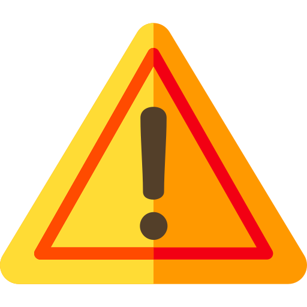

<!--
Peligro es una condición del entorno, no un evento: el hecho de que existan virus, ladrones o fallos.

No se puede eliminar el peligro. Lo que se administra es la exposición: no puedes evitar que existan los fraudes, pero sí evitar ser un blanco fácil.
-->

---

<!-- _class: split left fit -->
## Riesgo

<!--
Riesgo = probabilidad por impacto. Dos personas con el mismo peligro pueden tener riesgos muy distintos: la que usa la misma contraseña en todo y la que usa un gestor.

Se reduce de tres maneras: bajando la probabilidad (actualizar, no hacer clic), bajando el impacto (respaldos, límites bancarios) o aceptándolo con los ojos abiertos.
-->

---

<!-- _class: split fit -->
## Daño

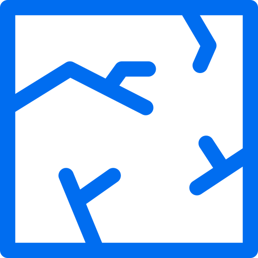

<!--
El daño es lo que queda: datos cifrados, dinero perdido, reputación, semanas sin poder facturar.

En la práctica el daño casi nunca es "me borraron los archivos". Suele ser "no puedo trabajar", que cuesta muchísimo más.
-->

---

<!-- _class: statement -->
## Ningún sistema es infalible

<!--
Frase de la presentación original y sigue siendo el resumen más honesto del oficio. La pregunta correcta no es "¿me van a atacar?", sino "¿cuánto tardo en darme cuenta y en recuperarme?".

De aquí sale la estructura del resto: prevenir, detectar, recuperar.
-->

---

<!-- _class: opener -->
02

# Fiabilidad informática

<!--
Fiabilidad: que el sistema haga lo que promete, cuando lo promete. En informática se mide con tres objetivos que a veces chocan entre sí.

Ejemplo del choque: cifrar todo mejora la confidencialidad, pero si pierdes la llave pierdes la disponibilidad.
-->

---

<!-- _class: statement -->
## Objetivos

<!--
Los tres de siempre, conocidos como la tríada CIA por sus siglas en inglés (confidentiality, integrity, availability). Vale la pena decir la sigla para que la reconozcan si la ven en otro lado.

Los tres se evalúan siempre juntos: una copia de seguridad sin cifrar protege la disponibilidad y falla la confidencialidad.
-->

---

<!-- _class: split fit -->
## Confidencialidad

<!--
Que la información la vea solo quien debe verla. Se rompe con robos de contraseña, filtraciones, capturas de pantalla o alguien mirando por encima del hombro.

Ejemplo cercano: el alumno que le presta la cuenta a un amigo "un rato" y luego aparece algo publicado que él no escribió.
-->

---

<!-- _class: split left -->
## Integridad

<!--
Que la información no cambie sin permiso ni se detecte. Es la más olvidada de las tres y la más peligrosa: si te alteran una calificación o una transferencia, el contenido existe pero es falso.

Ejemplo: alguien con acceso a la nube que cambia una nota del acta. El daño no es el robo, es la manipulación.
-->

---

<!-- _class: split fit -->
## Disponibilidad

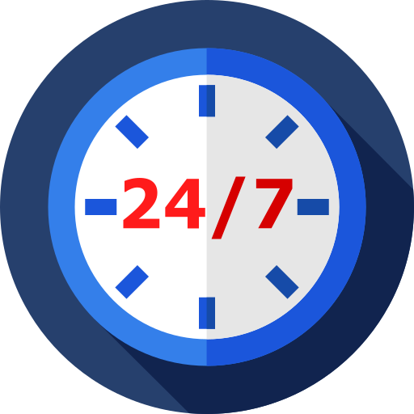

<!--
Que el sistema esté cuando se necesita. Es el objetivo que rompen los ataques de ransomware: no roban nada, simplemente impiden trabajar.

Ejemplo del bloque nuevo: Change Healthcare (2024). Clínicas y farmacias de EE. UU. sin poder cobrar durante semanas. Eso es daño por disponibilidad.
-->

---

<!-- _class: opener -->
03

# Proteger

<!--
Proteger ¿qué? Tres capas, siempre en este orden de fragilidad: hardware, software y datos. El hardware se reemplaza, el software se reinstala, los datos no vuelven solos.

La regla práctica: gasta el esfuerzo proporcional a lo que no puedes recuperar.
-->

---

<!-- _class: split fit -->
## Hardware

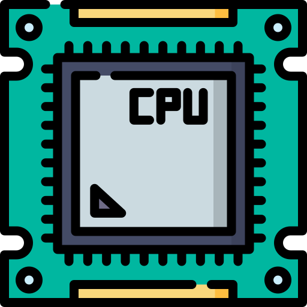

<!--
Equipos físicos: celular, laptop, router, impresora, cámaras. Se comprometen por robo, por pérdida o por USB conectado sin pensar.

Contramedidas: cifrado del disco, bloqueo por PIN o huella, y no conectar memorias de origen desconocido.
-->

---

<!-- _class: split left fit -->
## Software

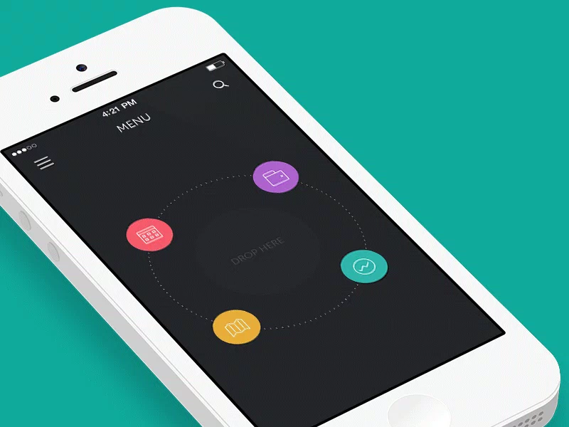

<!--
Sistemas operativos y aplicaciones. La mayoría de los ataques reales no adivinan contraseñas: entran por una versión sin actualizar.

Dato del DBIR 2026: el 31 % de las brechas ya empieza por un fallo de software, por delante de las credenciales robadas. Actualizar es seguridad, no mantenimiento.
-->

---

<!-- _class: split fit -->
## Datos

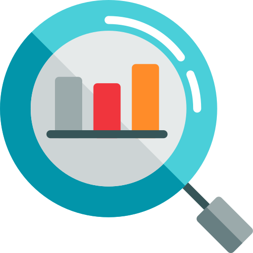

<!--
Lo único irrecuperable. Por eso lo que se protege de verdad son los datos: cifrado en reposo, copias fuera del equipo y permisos mínimos.

Si tuvieras que elegir una sola medida para toda la vida digital: respaldos que funcione probar restaurar.
-->

---

<!-- _class: opener -->
04

# Amenazas

<!--
Quién ataca y cómo se clasifica. La división clásica del original sigue sirviendo: personas (pasivas y activas), amenazas lógicas y amenazas físicas.

Importante para el grupo: la amenaza más probable no es un genio en una película, es alguien que conoce sus hábitos.
-->

---

<!-- _class: statement -->
## Personas

<!--
La primera fuente de amenazas. Se dividen en pasivas, que aprovechan un descuido, y activas, que buscan activamente el fallo.

En ambas, el blanco suele ser la confianza, no la tecnología.
-->

---

<!-- _class: statement -->
## Pasivos

<!--
No buscan atacar: aprovechan lo que encuentran. El que mira una pantalla en el metro, el que encuentra una laptop desbloqueada, el que recibe un archivo por error.

No son menos peligrosos; simplemente no se organizan.
-->

---

<!-- _class: split fit -->
## Accidentes

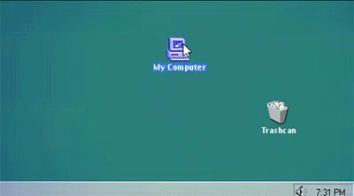

<!--
La causa más común de pérdida de datos y la que menos se cuenta: se cayó el celular, se borró la carpeta, se derramó café.

Un accidente no es un ataque, pero para los datos el resultado es idéntico. Por eso los respaldos existen.
-->

---

<!-- _class: split left fit -->
## Hackers

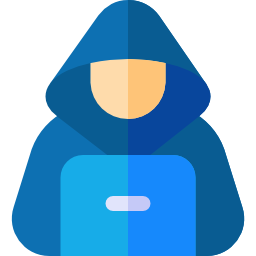

<!--
Término neutral en su origen: alguien que entiende un sistema lo bastante para modificarlo. En prensa se usa como "delincuente", y esa confusión vale la pena aclararla.

Los hay de sombrero blanco (avisan del fallo), gris y negro (lo explotan).
-->

---

<!-- _class: split fit -->
## Curiosos

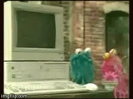

<!--
El que prueba "a ver qué pasa": adivina la contraseña del compañero, entra al correo que quedó abierto, revisa el celular ajeno.

No busca dañar, pero rompe la confidencialidad igual. Y muchas veces es el inicio de algo peor.
-->

---

<!-- _class: statement -->
## Activos

<!--
Buscan el fallo a propósito, con método y tiempo. Se dividen por motivación: dinero, ideología, espionaje o simplemente prestigio.

Aquí están los crackers, los antiguos empleados y los grupos criminales organizados.
-->

---

<!-- _class: split left -->
## Antiguos empleados

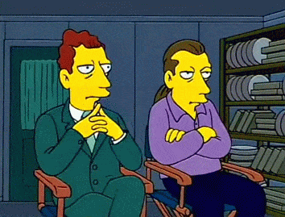

<!--
Riesgo real y poco hablado: quien se va conserva el conocimiento, las contraseñas viejas y a veces el acceso.

Buena práctica: dar de baja cuentas el mismo día de la salida y rotar las claves compartidas.
-->

---

<!-- _class: split -->
## Crackers

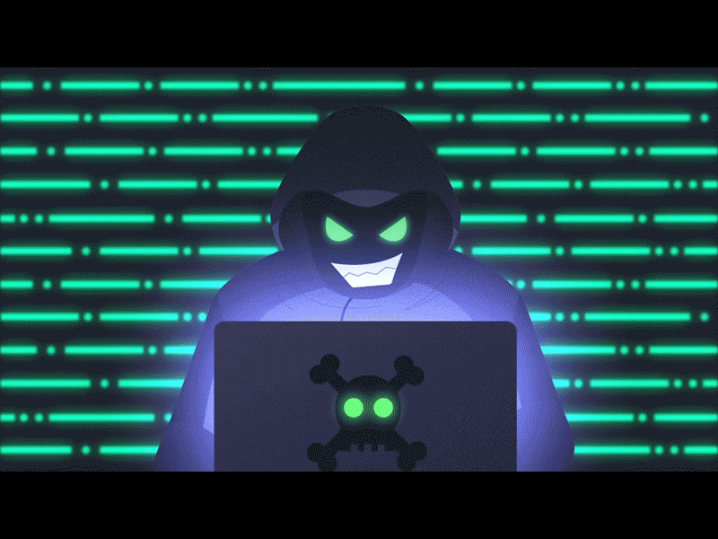

<!--
El que rompe protecciones por beneficio o por reto: saltarse licencias, extraer datos, vender accesos.

Diferencia con el hacker: el cracker busca el daño o el lucro, no el conocimiento.
-->

---

<!-- _class: split left -->
## Piratas informáticos

<!--
El término de prensa para la delincuencia organizada digital. Hoy casi siempre detrás de un negocio: ransomware como servicio, venta de datos, fraude con tarjetas.

En 2026 ya no son individuos: son empresas con turnos, soporte y reputación.
-->

---

<!-- _class: opener -->
05

# Amenazas lógicas

<!--
Programas y código malicioso. Es la parte que más creció y la que más rápido cambia, así que conviene enseñar categorías, no nombres de virus concretos.

Los nombres caducan; las categorías siguen sirviendo años después.
-->

---

<!-- _class: statement -->
## Intencionadas

<!--
Malware con propósito: alguien lo escribió para algo. Se dividen por objetivo (robar, cifrar, espiar, molestar) y por vector (correo, USB, descarga, app).

Las no intencionadas son los fallos: software incorrecto que rompe solo.
-->

---

<!-- _class: split fit -->
## Virus y malware

<!--
Malware es el término paraguas: virus, troyanos, gusanos, spyware, ransomware, infostealers.

Uno de los más relevantes hoy es el infostealer: no cifra nada, solo copia contraseñas y cookies de sesión. Silencioso y muy rentable.
-->

---

<!-- _class: split left fit -->
## Herramientas de seguridad

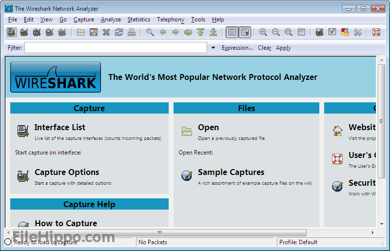

<!--
Los atacantes no usan programas misteriosos: usan las mismas herramientas que los profesionales de seguridad, a veces las legítimas.

Wireshark, Nmap o Metasploit son herramientas de diagnóstico. La diferencia entre un analista y un atacante es el permiso, no el programa.
-->

---

<!-- _class: split fit -->
## Puertas traseras

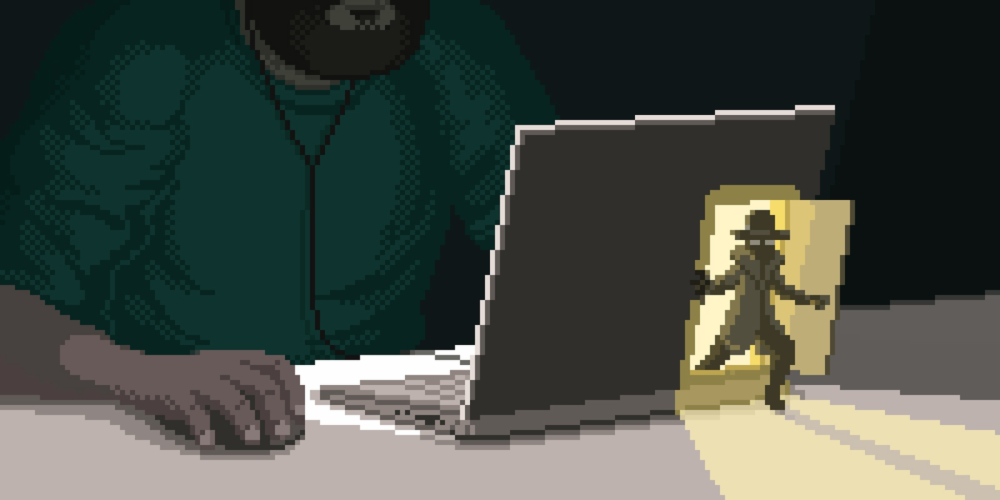

<!--
Accesos que alguien deja abiertos para volver después: un usuario de más, una clave compartida, un servicio remoto sin contraseña.

Duran meses y no se detectan por antivirus, porque no son malware: son configuraciones.
-->

---

<!-- _class: split left fit -->
## Software incorrecto (Bugs)

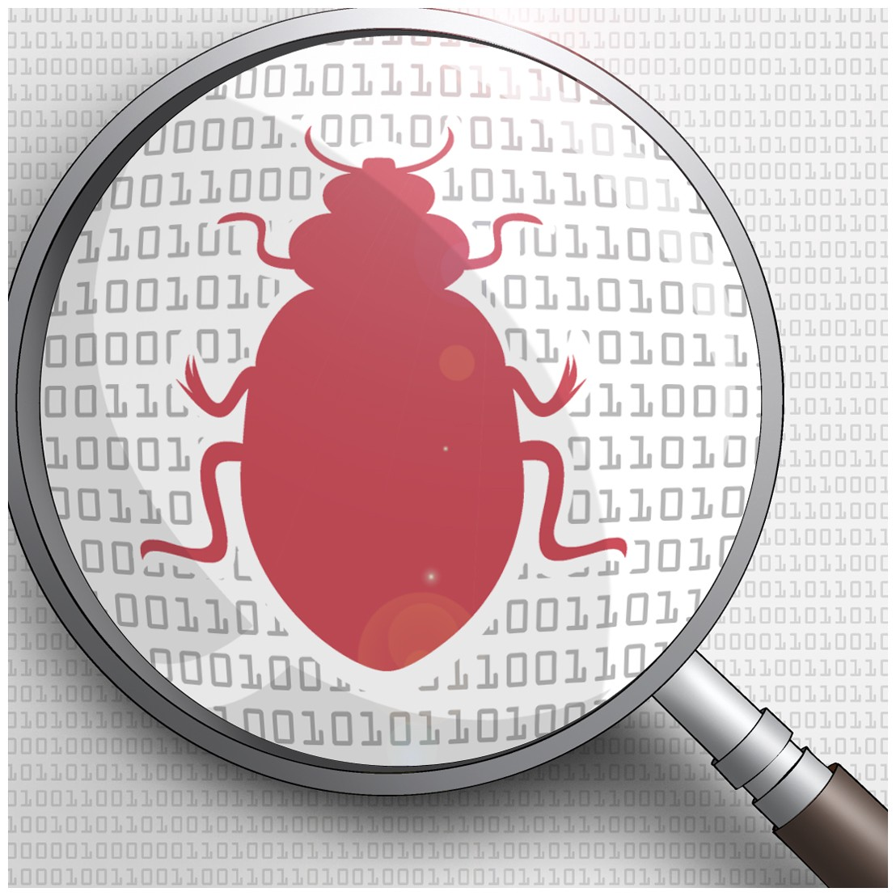

<!--
El fallo no intencionado. Muchos son inofensivos; unos pocos son graves, y esos son los que se convierten en noticia y en parche urgente.

Dos ejemplos del bloque nuevo: MOVEit (2023) y XZ Utils (2024). Un error, miles de víctimas.
-->

---

<!-- _class: opener -->
06

# Amenazas físicas

<!--
Las que se olvidan porque no dan miedo tecnológico: robo del equipo, pérdida, desastre (agua, fuego, apagón), sabotaje.

Un robo de laptop sin cifrado equivale a una filtración completa de datos.
-->

---

<!-- _class: opener -->
07

# Medidas de seguridad

<!--
Tres fases en el tiempo, y aquí está el esqueleto de la respuesta a un incidente: antes (prevención), durante (detección), después (recuperación).

Muchas empresas invierten solo en la primera. Las que sobreviven bien invierten en las tres.
-->

---

<!-- _class: opener -->
08

# Prevención

<!--
Lo que se hace antes de que pase. Cuatro medidas básicas que resuelven la mayoría de los casos reales.

Si el grupo solo se lleva cuatro cosas de toda la charla, que sean estas.
-->

---

<!-- _class: split fit -->
## Contraseñas

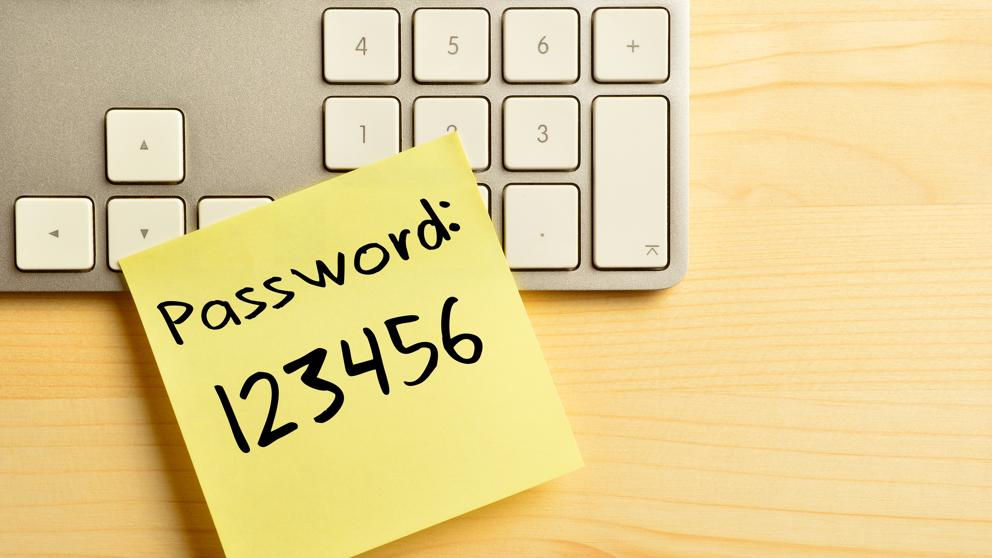

<!--
El clásico de la nota en el monitor. Dos reglas: una distinta por sitio y que no las recuerdes tú (gestor de contraseñas).

Complemento actual: passkeys, que eliminan la contraseña y usan la huella o el rostro del dispositivo.
-->

---

<!-- _class: split left fit -->
## Permisos de acceso

<!--
Cada persona, solo lo que necesita. En la práctica esto evita el 80 % de los daños internos: un alumno no debería poder borrar el expediente de otro.

En lo personal: revisa qué apps tienen acceso a tus contactos, fotos y ubicación.
-->

---

<!-- _class: split fit -->
## Seguridad de las comunicaciones

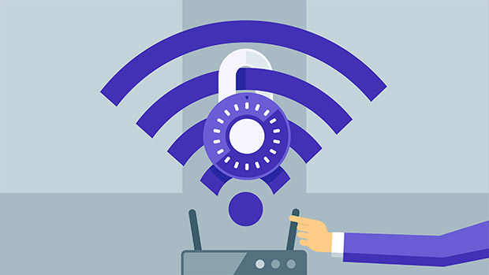

<!--
La información viaja por redes que no controlas. HTTPS, VPN y cuidado con el wifi público son la base.

Dato útil: si estás en una red abierta y el sitio no usa HTTPS, cualquiera puede leer lo que envías.
-->

---

<!-- _class: split left fit -->
## Actualizaciones

<!--
Cada actualización incluye parches de seguridad. Retrasarlas es dejar la puerta abierta con la llave puesta.

Dato del DBIR 2026: por primera vez, las vulnerabilidades de software superan a las contraseñas robadas como vía de entrada.
-->

---

<!-- _class: opener -->
09

# Detección

<!--
Si la prevención falla, hay que enterarse pronto. El tiempo de detección es la métrica que más cambia el daño final.

Si tardas seis meses en detectar, el atacante ya tiene todo y probablemente ya lo vendió.
-->

---

<!-- _class: split fit -->
## Antivirus

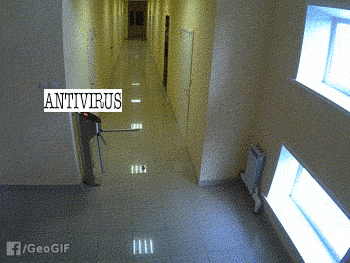

<!--
Compara archivos con firmas conocidas. Sigue siendo útil contra lo viejo, y es casi inútil contra lo nuevo o contra un ataque dirigido.

Por eso hoy se habla de EDR: detectar comportamiento raro, no solo nombres de virus.
-->

---

<!-- _class: split left fit -->
## Firewalls y proxis

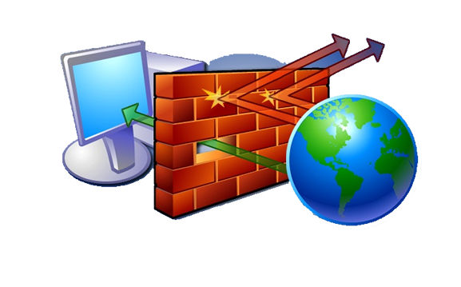

<!--
Deciden qué tráfico entra y sale. Un firewall mal configurado es como una puerta con la llave en la cerradura.

Los proxis además filtran contenido y registran quién pidió qué.
-->

---

<!-- _class: split fit -->
## Tor o redes VPN

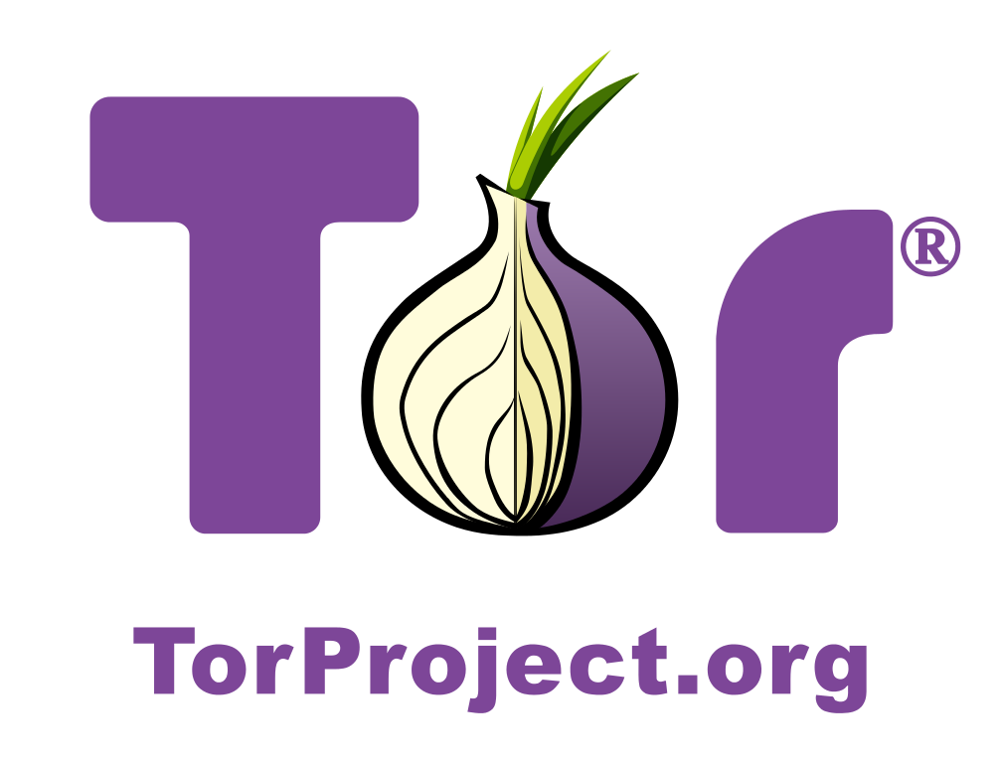

<!--
Ocultan el origen del tráfico. Sirven para proteger al periodista o al ciudadano bajo vigilancia; también para el atacante que quiere esconderse.

No son anónimos por sí solos: si inicias sesión con tu cuenta, ya estás identificado.
-->

---

<!-- _class: opener -->
10

# Recuperación

<!--
La fase que decide si un incidente es una anécdota o un desastre. Restaurar no es copiar archivos: es volver a operar.

Prueba de fuego: ¿cuánto tardarías en recuperar todo si mañana se cifrara el disco?
-->

---

<!-- _class: split left fit -->
## Respaldos

<!--
Regla 3-2-1: tres copias, en dos medios distintos, una fuera del lugar. Y la parte que se olvida: probar que restauran.

Un respaldo que nunca se ha probado no es un respaldo, es una esperanza.
-->

---

<!-- _class: opener -->
11

# Ingeniería social

<!--
La amenaza más eficaz y la más barata: convencer a alguien en lugar de romper un sistema.

No se arregla con tecnología, se arregla con criterio y con prisa evitada: el atacante necesita que actúes rápido.
-->

---

<!-- _class: statement -->
## Conductas que permiten obtener información confidencial

<!--
Engañar, presionar, hacerse pasar por otro, aprovechar una urgencia o una autoridad. El blanco siempre es una persona con acceso.

Señal de alarma universal: te piden algo con urgencia y por un canal distinto al habitual.
-->

---

<!-- _class: split fit -->
## Timo o fraude

<!--
La estafa clásica: un premio, una herencia, un certificado bancario falso. Hoy llega por correo y por WhatsApp.

Regla: si te ofrecen dinero y te piden datos primero, es fraude. Sin excepciones.
-->

---

<!-- _class: split left -->
## Robo de empleados

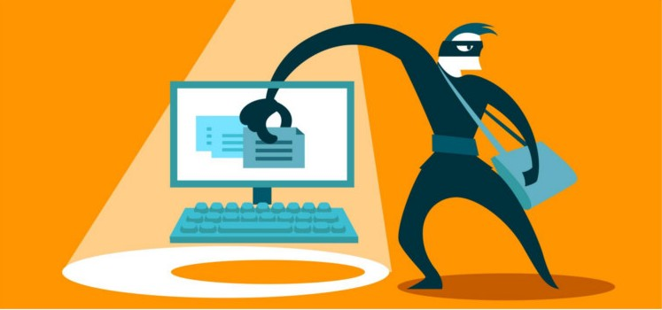

<!--
El robo interno, con acceso legítimo y sin alarma. Es el más difícil de detectar porque no hay nada "roto".

Contramedida: permisos mínimos y registro de quién hizo qué.
-->

---

<!-- _class: split fit -->
## Phishing

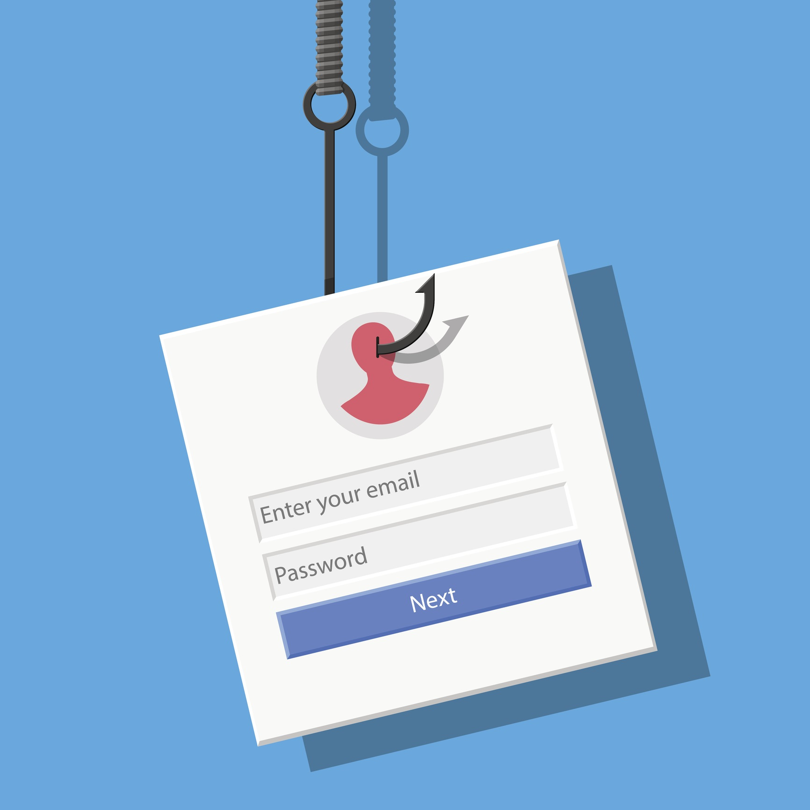

<!--
El clásico: te suplantan para que entregues contraseña o datos. Sigue siendo el ataque más usado del mundo.

Señales: dominio raro, prisa, saludo genérico, enlace que no coincide con el texto. Y hoy suma una nueva: puede estar escrito perfectamente.
-->

---

<!-- _class: split left -->
## Spoofing

<!--
Hacerse pasar por otro: número de teléfono falso, correo con remitente falsificado, hasta voz clonada.

Regla de oro: verifica por otro canal. Llama al número que ya tenías, no al que te acaban de escribir.
-->

---

<!-- _class: opener -->
12

# Evitar ataques

<!--
Cierre del bloque de ingeniería social, ahora en positivo: qué hacer en concreto cuando llega un mensaje sospechoso.

Son hábitos, no conocimientos técnicos.
-->

---

<!-- _class: split fit -->
## Comprobar autenticidad

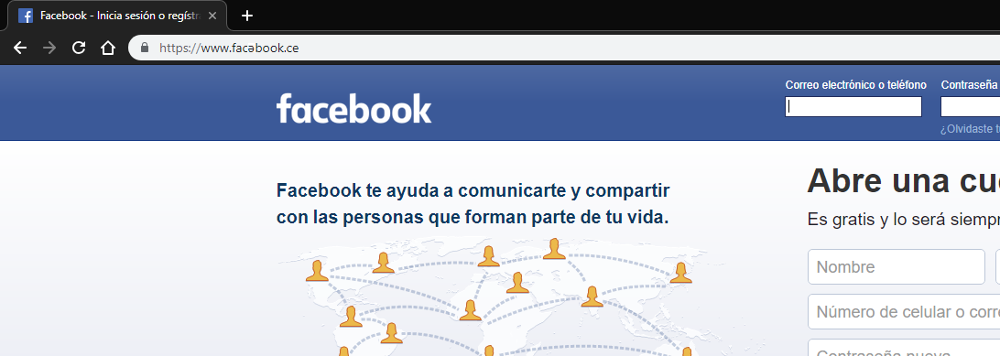

<!--
Antes de creer un mensaje, mira quién lo manda de verdad: dominio del correo, cuenta oficial, sello de verificación.

Cuidado: los verificados también pueden ser suplantados. Cuando hay dinero de por medio, verifica fuera de la app.
-->

---

<!-- _class: statement -->
## Analizar correo electrónico

<!--
Leer el correo con desconfianza: el remitente real (no el nombre que se muestra), los enlaces antes de hacer clic, los archivos adjuntos que no pediste.

Ejercicio rápido en clase: abrir el detalle de un correo y comparar el nombre visible con la dirección real.
-->

---

<!-- _class: split left fit -->
## No responder solicitudes

<!--
Ningún banco, ninguna plataforma y ningún profesor piden un código de verificación. Ese código es la llave: quien lo tiene, entra.

Si alguien te lo pide, es suplantación. Sin excepciones, aunque el mensaje venga de un conocido: su cuenta puede estar robada.
-->

---

<!-- _class: statement -->
## Nunca se debe solo tirar documentación sensible

<!--
Papel y dispositivos. La basura es una fuente de datos: facturas, recibos, formularios con datos personales.

Contramedida: trituradora para papel, borrado seguro o destrucción física para discos y memorias.
-->

---

<!-- _class: opener -->
13

# Contraseñas

<!--
El tema que todos creen dominar y casi nadie aplica bien. La regla moderna cambió: largo y único le gana a "complicado y difícil de recordar".

Lo que veremos: cómo se construye una buena, cómo se guarda y qué las sustituye.
-->

---

<!-- _class: split fit -->
## Fáciles de recordar, difíciles de adivinar

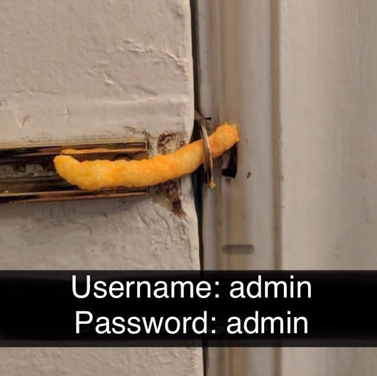

<!--
La frase del original sigue vigente. Una contraseña larga de palabras sin relación es más fuerte y más fácil de recordar que una corta con símbolos.

Ejemplo: cuatro palabras al azar superan a "P@ssw0rd1", que ya está en todas las listas.
-->

---

<!-- _class: statement -->
## Aa-Zz 0-9 !"#$%&/()=?

<!--
Combinar mayúsculas, minúsculas, números y símbolos amplía el espacio de búsqueda, pero menos de lo que la gente cree.

Longitud primero. Ocho caracteres con símbolos caen en minutos; veinte sin símbolos, no.
-->

---

<!-- _class: statement -->
## Sin secuencias ni caracteres repetidos

<!--
123456, qwerty, aaaa, la fecha de cumpleaños. Los atacantes no prueban al azar: prueban primero lo previsible.

Un buen gestor de contraseñas evita todo el problema: genera aleatorias y las guarda por ti.
-->

---

<!-- _class: opener -->
14

# Protección de la información

<!--
Cómo se protege la información cuando ya está guardada o viajando. La herramienta central es la criptografía.

No hace falta matemáticas: basta entender qué garantiza y qué no.
-->

---

<!-- _class: split left fit -->
## Encriptación

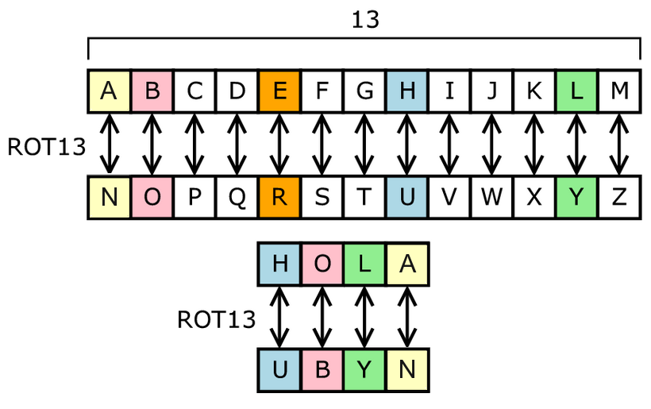

<!--
Transformar el mensaje con una clave. Sin la clave, el contenido es ruido. El ejemplo del ROT13 es histórico y didáctico, pero hoy se usa AES o RSA.

Ojo: cifrar no es lo mismo que codificar. Base64 se decodifica sin clave; no protege nada.
-->

---

<!-- _class: opener -->
15

# Ejemplos

<!--
Casos concretos, empezando por los clásicos que siguen en los libros y terminando en el bloque nuevo, con lo de 2024-2026.

La idea es que reconozcan el patrón, no que memoricen fechas.
-->

---

<!-- _class: case fit -->
## Fuerza bruta

- Hoy: listas filtradas

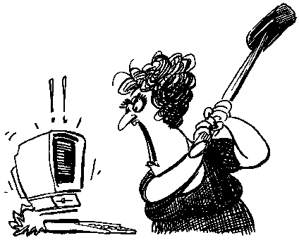

<!--
Probar todas las combinaciones es lentísimo y los sistemas bloquean por intentos.

Hoy se hace credential stuffing: se toman millones de correo-contraseña de filtraciones y se prueban en otros sitios. Funciona porque repetimos contraseña.
-->

---

<!-- _class: split left -->
## RubberDucky (2010)

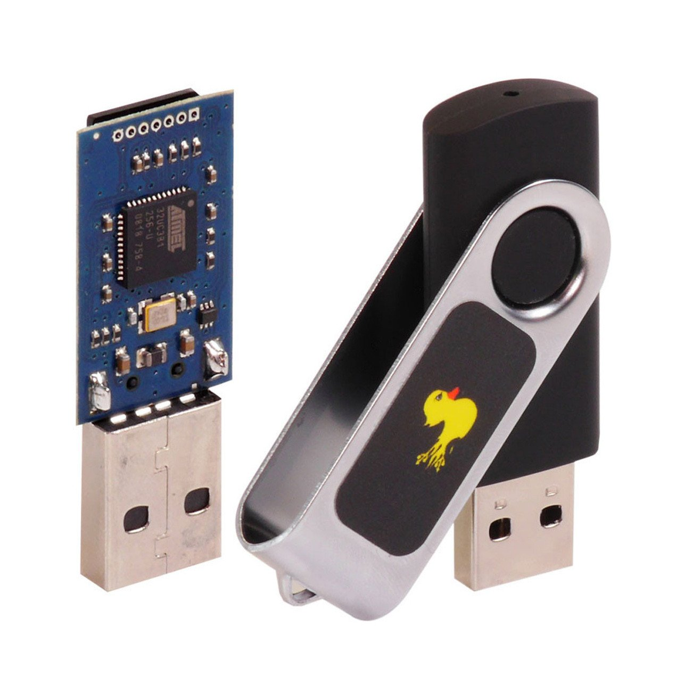

<!--
Un USB que se hace pasar por teclado y escribe comandos solo en segundos. Se presentó en 2010 y sigue vendiéndose.

Hoy el equivalente cotidiano es peor: un cable o una memoria "de regalo" que instala algo al conectarla. Regla: no conectes memorias que no son tuyas.
-->

---

<!-- _class: split fit -->
## Phishing

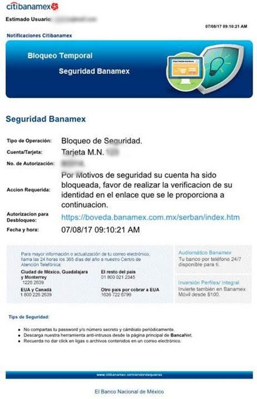

<!--
Ejemplo visual del engaño: una web casi idéntica a la real que pide usuario y contraseña.

Fíjate en el detalle que delata: el dominio. Las copias suelen tener una letra de más o un guion en lugar de un punto.
-->

---

<!-- _class: split left fit -->
## Llaves electrónicas

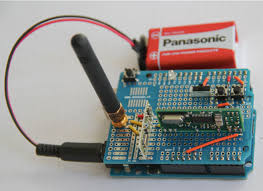

<!--
Tokens físicos con clave propia: la llave que genera un código que cambia cada 30 segundos.

Sirven porque la contraseña sola no basta. Es la versión física del 2FA, y por eso se usa en bancos y en acceso a servidores.
-->

---

<!-- _class: split -->
## Femtoceldas (2011)

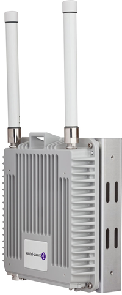

<!--
Una antena pequeña que da cobertura en interiores. En manos maliciosas, un IMSI catcher: se hacen pasar por la red y capturan la conexión.

Es el precursor conceptual del SIM swapping, que es el ataque que hoy sí les puede tocar: duplican tu SIM y reciben tus SMS.
-->

---

<!-- _class: split left fit -->
## Ransomware

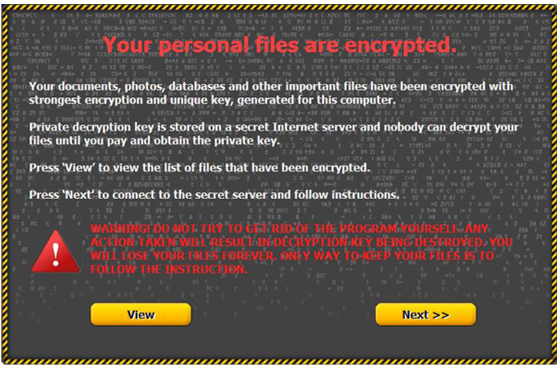

<!--
Cifra tus archivos y pide un rescate. En 2017, WannaCry paralizó hospitales en decenas de países.

Modelo actual: doble extorsión. Cifran, copian los datos y amenazan con publicarlos. Pagar no garantiza nada.
-->

---

<!-- _class: split fit -->
## Stuxnet (2010)

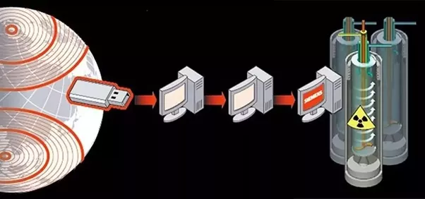

<!--
La primera ciberarma documentada: sabotaje físico de centrífugas por software, sin un solo disparo.

Su valor en clase es histórico: demostró que el código puede destruir cosas. Su heredero moderno es Industroyer2 (2022), contra la red eléctrica.
-->

---

<!-- _class: split left -->
## Keylogger

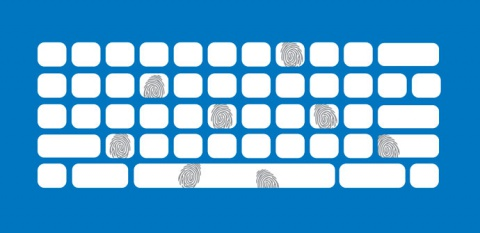

<!--
Registra las teclas y las envía por internet. Puede ser hardware (un adaptador entre teclado y equipo) o software.

En lo personal, el riesgo real está en el celular: teclados o apps de terceros que piden permisos de accesibilidad.
-->

---

<!-- _class: diptych -->
## Jailbreak y root

 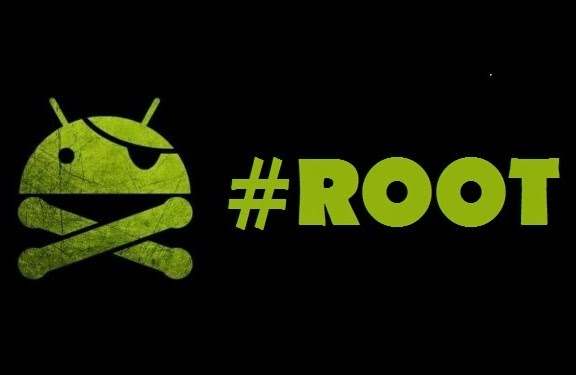

<!--
Quitar las restricciones del sistema para instalar lo que a uno le dé la gana. Ventaja: control. Desventaja: desaparece el control de seguridad del fabricante.

Es la puerta del sideloading: instalar APK fuera de la tienda. Por ahí entran muchos troyanos bancarios en Android.
-->

---

<!-- _class: diptych -->
## Memorias "perdidas" o "enviadas"

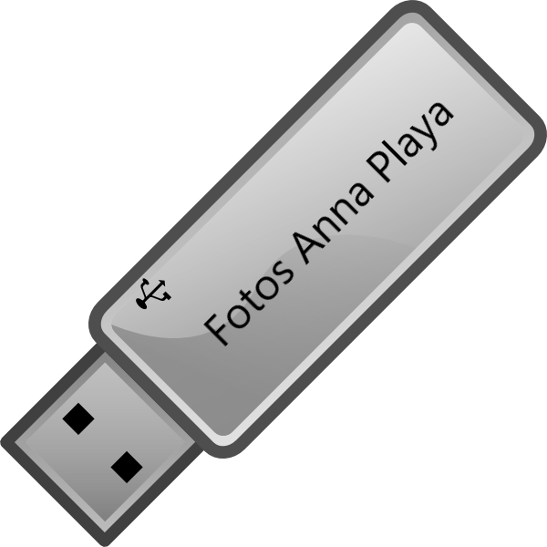 

<!--
Dos casos: la memoria que se pierde (y encuentra alguien) y la que se "envía" en una promoción o evento.

También aplica a cargadores públicos y cables de regalo: el puerto USB puede hacer más que cargar.
-->

---

<!-- _class: split -->
## No confiar en nadie

<!--
La desconfianza metódica como hábito: el wifi del hotel, el cargador de la habitación, el USB del evento.

No es paranoia: es tratar todo entorno desconocido como público.
-->

---

<!-- _class: case left fit -->
## El chip que nunca existió

- Bloomberg, 2018

<!--
En 2018 Bloomberg publicó que unos chips diminutos en servidores Supermicro espiaban a empresas. La historia se volvió célebre.

Apple, Amazon y Supermicro lo desmintieron, y nunca se presentó una prueba pública. Lección para la clase: ni un medio grande basta; contrasta antes de creer.
-->

---

<!-- _class: opener -->
16

# Amenazas actuales

<!--
Bloque nuevo, con datos de 2025-2026. Aquí cambia el mensaje: el ataque ya no empieza casi siempre por una contraseña mal elegida, sino por un sistema sin actualizar.

Fuente principal: Verizon DBIR 2026 (incidentes de noviembre de 2024 a octubre de 2025) e IBM Cost of a Data Breach 2026.
-->

---

<!-- _class: stats -->
## Cómo se ataca

- **31%** Fallos de software
- **48%** Ransomware

<!--
DBIR 2026: el 31 % de las brechas empieza por una vulnerabilidad de software. Es la primera vez que supera a las credenciales robadas como vía de entrada.

Y el 48 % de las brechas involucra ransomware, aunque los pagos bajan porque más empresas se niegan a pagar.
-->

---

<!-- _class: stats -->
## Lo que cuesta

- **US$4.99 M** Por brecha

<!--
IBM 2026: el costo medio global de una brecha llegó a 4.99 millones de dólares, un 12 % más que el año anterior y récord histórico.

El mismo informe da dos datos que vale la pena decir de viva voz: los ataques asistidos por IA (deepfakes y malware generado) crecieron un 56 %, y automatizar la seguridad con IA ahorra 1.93 millones por incidente.

La idea que queda: la IA abarata atacar y también abarata defender. La diferencia la hace quién la usa primero.
-->

---

<!-- _class: case -->
## Ransomware: cobrar dos veces

- 190 millones afectados

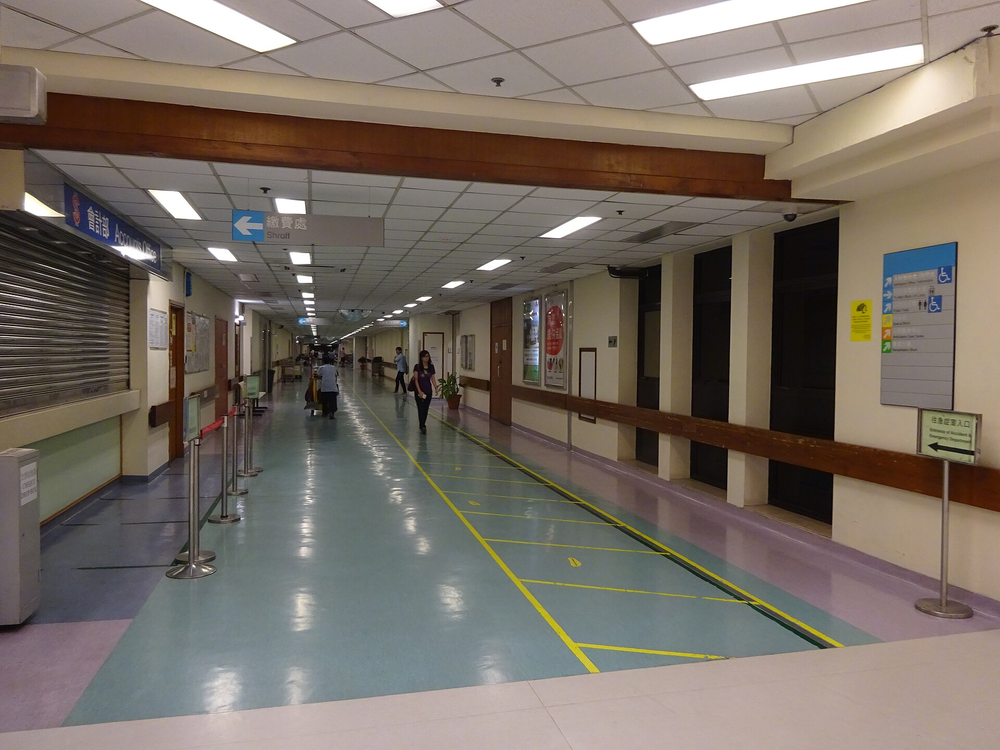

<!--
Change Healthcare (EE. UU., 2024): el ataque paralizó el sistema de pagos médicos. Clínicas y farmacias sin poder cobrar durante semanas.

La empresa pagó 22 millones de dólares de rescate y aun así los datos se publicaron. 190 millones de personas afectadas: la mayor filtración sanitaria registrada.

Moraleja: pagar no compra silencio, solo tiempo.
-->

---

<!-- _class: case left -->
## Un fallo basta

- MOVEit 2023 · XZ Utils 2024

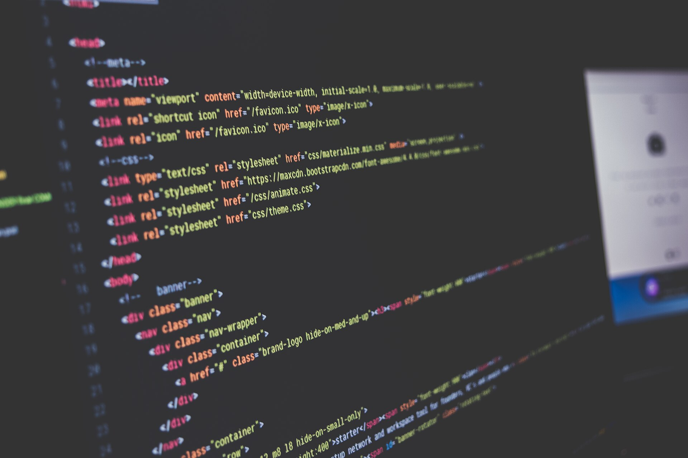

<!--
MOVEit (2023): una vulnerabilidad en un programa de transferencia de archivos. Miles de organizaciones expuestas por un solo fallo, sin phishing ni contraseñas.

XZ Utils (2024): una puerta trasera estuvo a punto de entrar en Linux; la detectó un ingeniero por una demora de medio segundo en la conexión SSH. Precaución de un solo experto evitó un desastre mundial.

Lección: actualizar y revisar dependencias no es burocracia.
-->

---

<!-- _class: case -->
## Deepfakes: la videollamada falsa

- US$25 M

<!--
Arup (Hong Kong, 2024): un empleado participó en una videollamada con lo que parecían su director financiero y varios colegas. Todos eran deepfakes. Autorizó transferencias por 25 millones de dólares.

La imagen de la diapositiva es un rostro sintético generado por StyleGAN: no es una persona real.

Dato: bastan 3 segundos de audio para clonar una voz. Regla: verificar por otro canal, nunca por el número o el video que te acaban de enviar.
-->

---

<!-- _class: case left -->
## Te roban la sesión

- No la contraseña

<!--
Un infostealer no cifra ni pide rescate: copia contraseñas guardadas en el navegador y las cookies de sesión. Con la cookie, entra a tu cuenta sin necesitar tu contraseña ni tu 2FA.

Se reparte con juegos pirateados, mods, "cheats" y cracks. Muy común entre jugadores.

Defensa: no guardes contraseñas en el navegador, usa 2FA con app y revisa las sesiones activas.
-->

---

<!-- _class: list -->
## Montadeudas

- 1 073 apps ilegales en México

<!--
Consejo Ciudadano (2025): 1 073 apps de préstamo ilegal identificadas entre 2021 y 2024; 397 seguían activas. CONDUSEF recibió 29 000 reportes en 2024, un 80 % más.

Ofrecen préstamos inmediatos y piden permisos de contactos, cámara y fotos. Luego extorsionan con imágenes alteradas y mensajes a la familia. El 60 % de las víctimas son mujeres.

Regla: si una app pide contactos y no es de contactos, no la instales.
-->

---

<!-- _class: case left -->
## Phishing 2.0

- Smishing · quishing

<!--
Smishing: SMS con "paquete retenido", "multa" o "tu cuenta será bloqueada". CONDUSEF advirtió en 2026 de envíos masivos de mensajes falsos de multas y paquetes.

Quishing: códigos QR falsos en anuncios, menús y parquímetros que llevan a sitios clonados.

Y el texto ya viene escrito por IA: sin faltas de ortografía, con tu nombre real.
-->

---

<!-- _class: list -->
## Sextorsión

- No pagues, denuncia

<!--
Te escriben diciendo que tienen fotos o videos tuyos, a veces con una contraseña vieja real para dar miedo. Casi siempre es un engaño masivo.

No pagues: pagar no detiene la extorsión, la confirma y la financia. No reenvíes nada, guarda capturas y denuncia.

En México: Policía Cibernética y Fiscalía. Acompañar a quien lo vive importa tanto como la denuncia.
-->

---

<!-- _class: opener -->
17

# Defensa hoy

<!--
Cierre en positivo: tres cosas que sí funcionan y que pueden empezar a hacer esta tarde.

Nada de esto requiere ser experto.
-->

---

<!-- _class: list -->
## El fin de la contraseña

- Passkeys

<!--
Las passkeys sustituyen la contraseña por la huella o el rostro del dispositivo. No hay nada que robar: no viaja ningún secreto que el atacante pueda reutilizar.

FIDO Alliance reporta acceso habilitado a 15 000 millones de cuentas.

Complemento: 2FA con app, no por SMS (el SMS se intercepta con SIM swapping) y un gestor de contraseñas.
-->

---

<!-- _class: list -->
## Lo que sí funciona

- Actualiza · 2FA · respaldos

<!--
Actualiza sistema, apps y router: la vía de entrada número uno hoy es un fallo sin parchear.

2FA con app o passkeys, y un gestor de contraseñas para no repetir.

Respaldos 3-2-1 y pruébalos. Y un hábito: la urgencia es la firma del fraude. Si te apuran, verifica por otro canal.
-->
