<!-- _class: cover -->
<!-- _paginate: false -->
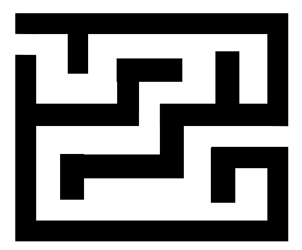

Cultura Digital

# Algoritmos

Pasos claros para resolver problemas.

---

<!-- _paginate: false -->

---

<!-- _class: split -->

  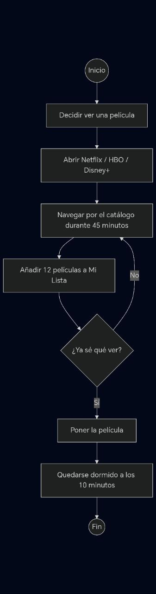

  
Cotidiano

  <h2>Ya usas algoritmos.</h2>
  
En recetas, rutas y apps.

---

<!-- _class: center-slide -->

## Una secuencia ordenada de pasos.

---

<!-- _class: center-slide -->

## Para resolver un problema.

---

<!-- _class: split -->

  
Anatomía

  <h2>Entrada. Proceso. Salida.</h2>

  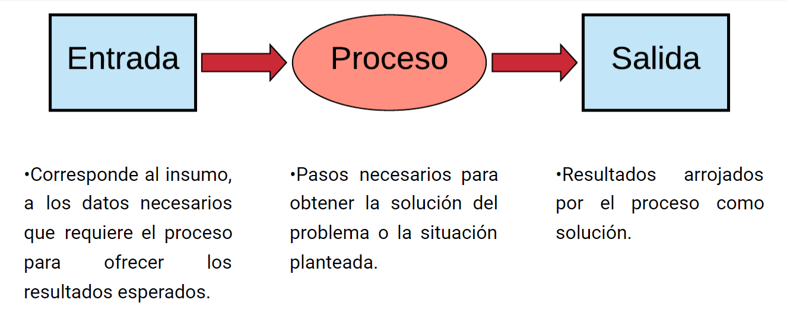

---

<!-- _class: center-slide -->

Entrada

## Lo que necesitas.

---

<!-- _class: center-slide -->

Proceso

## Lo que haces.

---

<!-- _class: center-slide -->

Salida

## Lo que verificas.

---

<!-- _class: center-slide -->

## ¿Falló entrada, proceso o salida?

---

<!-- _class: split -->

  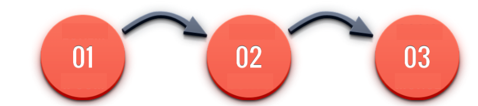

  
Orden

  <h2>El orden importa.</h2>

---

<!-- _class: center-slide -->

## Mismos pasos, distinto resultado.

---

<!-- _class: split -->

  
Precisión

  <h2>La precisión importa.</h2>

  

---

Ambigua

“Ponle tantita leche.”

Precisa

“Vierte <strong>250 ml</strong> de leche.”

---

<!-- _class: split -->

  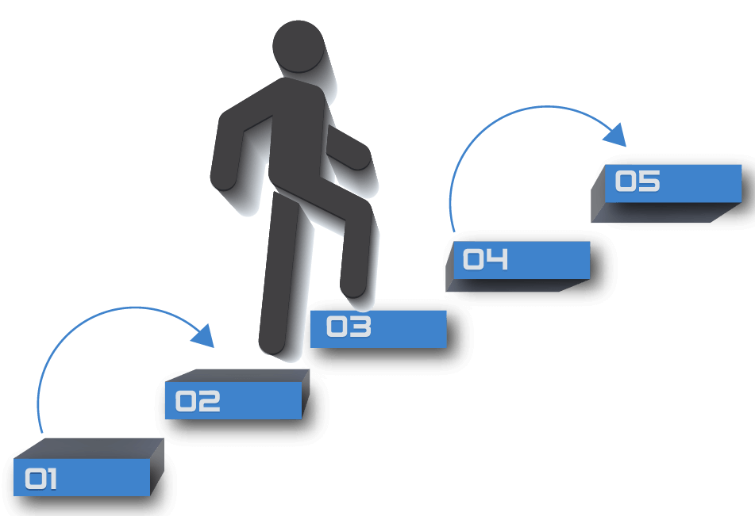

  
Ciclo

  <h2>Diseña la solución primero.</h2>

---

<!-- _class: split -->

  
Ciclo

  <h2>Traduce a una herramienta.</h2>

  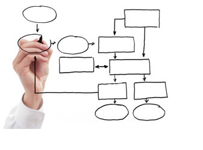

---

<!-- _class: center-slide flow -->

Diagramas de flujo

## Ejemplos claros y visuales.

---

<!-- _class: split flow -->

  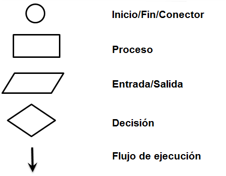

  
Ejemplo

  <h2>Símbolos básicos</h2>

---

<!-- _class: split flow -->

  
Ejemplo

  <h2>Abrir una puerta</h2>

  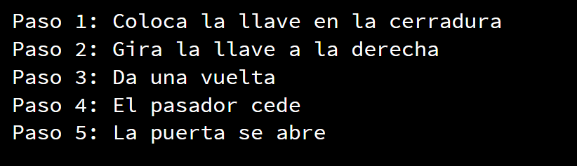

---

<!-- _class: split flow -->

  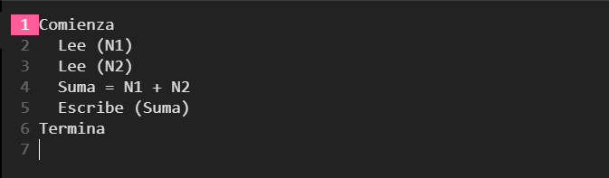

  
Ejemplo

  <h2>Sumar dos números</h2>

---

<!-- _class: split flow -->

  
Ejemplo

  <h2>¿Vas al cine?</h2>

  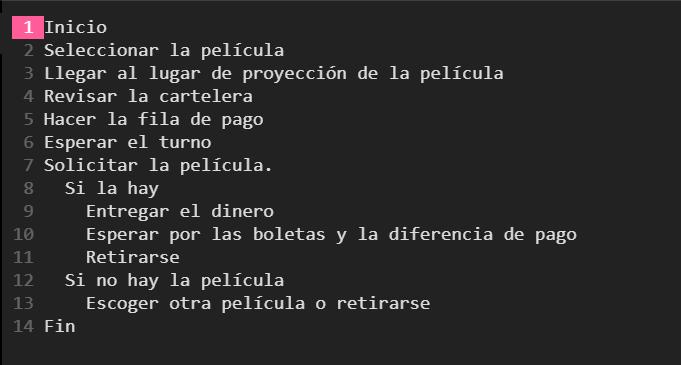

---

<!-- _class: split flow -->

  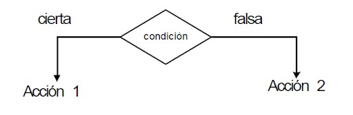

  
Ejemplo

  <h2>Decisión simple</h2>

---

<!-- _class: split flow -->

  
Ejemplo

  <h2>Un bucle</h2>

  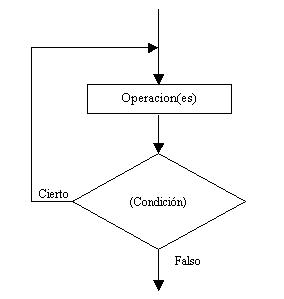

---

<!-- _class: split flow -->

  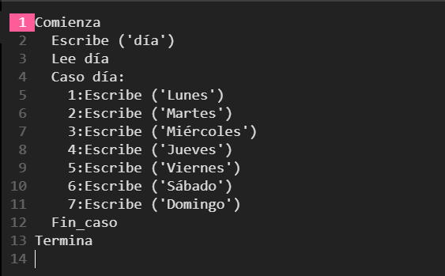

  
Ejemplo

  <h2>Días de la semana</h2>

---

<!-- _class: center-slide -->

## Prueba, valida y corrige.

---

<!-- _class: center-slide -->

## El error también enseña.

---

<!-- _class: split -->

  
Reto 15 min

  <h2>Robot Humano</h2>
  
Da instrucciones literales.

  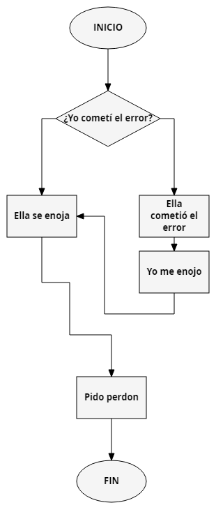

---

<!-- _class: split -->

  <a href="https://g.co/doodle/ygxau2?ds=cl" target="_blank">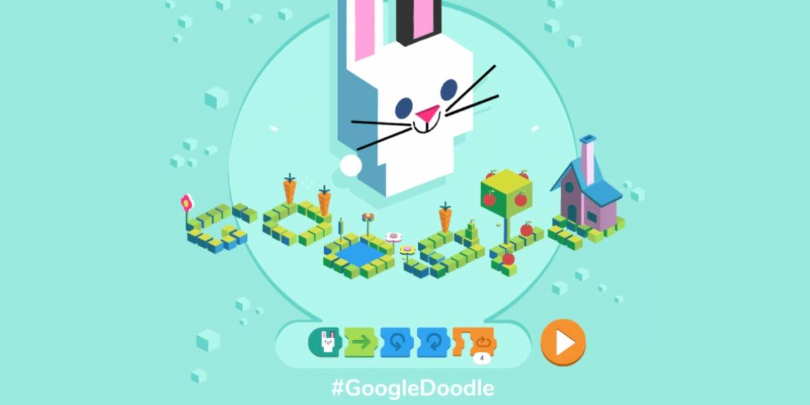</a>

  
Reto 25 min

  <h2><a href="https://g.co/doodle/ygxau2?ds=cl" target="_blank">Conejo y zanahorias</a></h2>
  
Diseña, prueba y mejora.

---

<!-- _class: center-slide -->

## Descompón. Sé preciso. Valida.

---

<!-- _class: center-slide closing -->
<!-- _paginate: false -->

## Primero piensa la **solución**.

---

<!-- _class: center-slide closing -->
<!-- _paginate: false -->

## Luego elige la **herramienta**.
